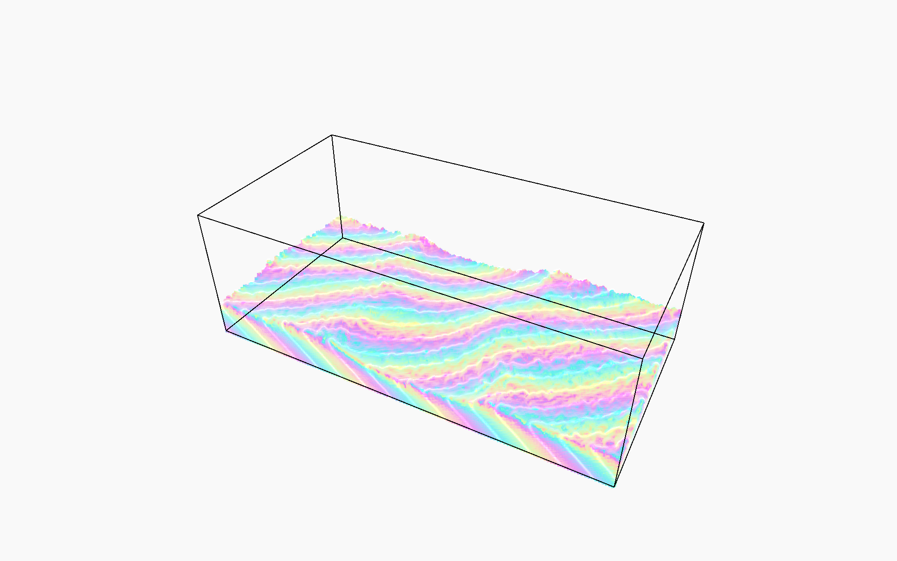

# Wisp

  
   
  <em>A Computational Fluid Dynamics Simulation based on SPH, implemented using Vulkan + CUDA Interop</em>

Perhaps, this is an extension to my [2D Fluid Simulator](https://github.com/irrevocablesake/Ryutai). 

One fine Friday, I was hunting for a project idea to keep myself busy over the weekend. But, what was supposed to be a weekend project, turned into a 3 week fun journey of delving into Maths, Physics and Optimizations. All the effort was spent to implement a simulation model known as Smoothened Particle Hydro-dynamics ( Physics based ). And representing the model results as discrete particles. Eventually, a surface was approximated through fragment shader computations, known as Screen Space Fluid ( SSF ), to give the fluid a more uniform look.

## Index

- [Algorithm](#Algorithm)
- [Architecture](#Architecture)
- [Rendering](#Rendering)
- [Simulation](#Simulation)
- [Performance](#Performance)
- [Results](#Results)
- [Profiling](#Profiling)
- [References](#References)
## Algorithm

The idea remains quite similar to our 2D simulation: Fluids flow. But this time, instead of representing the fluid using fields on a grid, we represent it using individual particles. Each particle represents a small portion of the fluid and carries properties such as position, velocity and mass. Together, these particles allow us to approximate the behavior of a continuous fluid.

At the highest level, the simulation revolves around three important physical properties:
- _**Density:**_ Tells us how much fluid mass is packed into a given region. It helps us understand how compressed or spread out the fluid is.
- _**Pressure:**_ Determines how particles push against their neighbours, resisting compression and helping maintain the fluid's volume.
- _**Viscosity:**_ Determines how much neighbouring particles resist relative motion, giving the fluid its characteristic resistance to flow.

A general flow of the program can be thought of as follows:
- _**Initialization:**_ We start with a lattice of particles, initially at rest. Each particle has an associated mass, and the initial arrangement establishes the fluid's resting density.
  - At every simulation _iteration_, we perform the following operations, updating the state of the particles based on their surroundings:
    - _**Compute density:**_ Each particle examines its neighbours to estimate the amount of fluid surrounding it.
    - _**Compute pressure:**_ Using the estimated density, we determine how much pressure each particle experiences.
    - _**Compute pressure forces:**_ We calculate the forces exerted by neighbouring particles due to pressure. These forces resist compression and drive the fluid apart where necessary.
    - _**Compute viscosity forces:**_ We calculate the resistance to relative motion between neighbouring particles, helping smooth out their velocities.
    - _**Update particles:**_ We combine the resulting forces with external forces such as gravity to update particle velocities and positions.

Additionally, we employ a few techniques to improve the behaviour of the simulation:
- _**XSPH:**_ Helps **smoothen** noisy particle velocities by blending a particle's velocity with those of its neighbours.
- _**Surface Tension:**_ Helps maintain **cohesion** between surface particles, preventing the fluid from looking overly scattered.
- _**Vortex Force:**_ Introduces **additional energy** into the system, helping sustain interesting rotational motion instead of allowing the fluid to quickly settle into equilibrium.

The result is a collection of particles whose collective behaviour _**approximates**_ a flowing 3D fluid.

## Architecture

The Graphics API used is **Vulkan**, whilst **CUDA** is used for **GPGPU** computations. I could have used Vulkan-Compute itself, but I saw this as an opportunity to solidify my knowledge about CUDA and **Interop**. 

The architecture maintains a buffer in memory, accessible to both, and synchronized access to it through semaphores, due to which we save a lot of instruction operations in memory access. This is required because Vulkan engine initializes the particles with properties like position, velocity etc.. and writes them to the common memory area. CUDA reads from the same, does physics computation and updates the same shared memory. Vulkan displays the updated data.

A small mistake that i hadn't caught early on was not creating the shared buffer with "dedicated" flag, due to which the buffer didn't reside in GPU VRAM and costed a lot of operations in memory access. A quick fix to that was allowing a dedicated device memory along with staging buffer data upload at the start.

Another idea, which inherently is part of the algorithm, is comparing current particle with all the other particles. For a moment think about it, we have thousands ( if not millions ) of particles. If we compare a every single particle with all the other particles - the Time Complexity is going to explode because the algorithm is per frame ( and SUB STEPPED ). A common way to avoid this is to divide our 3D world into a "uniform 3D Grid" ( cells / voxels ), certainly each particle must fall into some cell. We form such lists that tell us in what cell which particle resides, and then instead of comparing against all the particles, we compare the current particle with the particles that fall in the the surrounds 26 cells.

Well, that's the algorithm, but if you see it also involves a lot of memory access. Since, the particles data is read from the Interop memory ( it's a buffer ) and in simulation - obviously, any particle could reside in the 26 surrounding ( plus current particle cell ) cells, that implies a lot of cache misses when reading from the global Device VRAM. This, was solved through physically sorting the particle buffer after the particle-cell list was computed and single-handedly provided the biggest optimization result.

Rest other architectural changes were small: Thread size, block size, launch bounds, pragma unroll, restrict ( non overlapping access ) and shared memory ( faster access, instead of pulling from global memory ).

## Rendering

For Rendering, there are really 2 methods either use a Ray Marcher to extract a single surface and render it. Or, implement Screen Space Fluid through the fragment shader. I have chosen the latter for now.

We run the compute pipeline and update the data, run a depth-only graphics pipeline and write to a texture, then a final pipeline pass that renders the depth texture values as SSF. Additionally, there is another pipeline that draws the "wire" or the "room" bounds.

## Simulation

https://github.com/user-attachments/assets/0af89b60-4f19-4500-a13b-b92059dd3a14

## Performance

I was able to push my system i.e NVIDIA GeForce 4050 Mobile GPU to it's absolute limits. With a single sub-step, the system can handle a lot of particles. But Simulations require sub-stepping to get correct results in relation to frame, so with higher sub-steps the performance suffers slightly.

It may be quite easy to think that, we have to just optimize compute shaders and the performance will increase. Often, people forget that it's not just about fast computation but also the rasterization pipeline. At 4M or 5M particles, the rasterizer starts choking up due to memory bandwidth, throughput, and overdraw, unfortunately - there's just no way around it, we possibly may implement some smart techniques to overcome it but still there are limitations.

### Results

- **1 Sub-step:** 5M–6M particles @ 30–40 FPS
- **8 Sub-steps:** 300K–350K particles @ 30–40 FPS

## Profiling

For Profiling, I used the Holy Trinity i.e NSight Systems, NSight Compute and NSight Graphics. I would use them to find the bottle necks, cache throughput and overall work through put, weigh which process is taking the longest and improve them.

## References
- 
- 
- 
- 
- 
